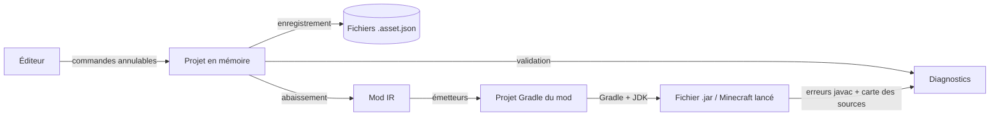

# 03. Architecture

## Vue d'ensemble

Mine Engine est découpé en modules à responsabilité unique. Le cœur ne sait rien de l'interface ni de Minecraft ; l'interface ne sait rien de la génération de code ; le générateur ne lit jamais un projet directement, il ne reçoit qu'une représentation intermédiaire déjà validée.

Le trajet d'un mod est toujours le même :

## Les modules

| Module | Rôle | Dépend de |
| --- | --- | --- |
| **Core** | Identifiants, élément de base, références, dossiers logiques, diagnostics, historique d'annulation, journal, écriture atomique, format JSON commun, traductions | rien |
| **Assets** | Les sortes d'éléments (item, bloc, mob, recette, texture, son, graphe), leurs règles de validation, leur lecture et écriture JSON, le registre des éléments, tout le modèle de programmation nodale | Core |
| **Project** | Organisation d'un projet sur le disque, paramètres, création, ouverture, enregistrement, import de fichiers, sauvegardes de secours, dossiers, verrouillage, projets connus, migration des anciens formats | Core, Assets |
| **IR** | Le Mod IR et sa construction : validation complète, puis traduction de chaque élément (abaissement), dont la compilation des graphes en instructions | Core, Assets, Project |
| **Minecraft** | Tout ce qui est propre au jeu : versions, MDK (bibliothèque, catalogue, inspection), backends Forge et NeoForge, émetteurs de ressources et de code Java, carte des sources | Core, IR |
| **Generator** | Orchestration d'une génération : préparation du workspace, exécution des émetteurs, suppression des fichiers devenus inutiles | Core, IR, Minecraft |
| **Build** | Chaîne complète : choix du MDK, génération, recherche d'un JDK, exécution de Gradle, lecture des erreurs | Core, Project, IR, Minecraft, Generator |
| **Editor** | L'interface : vues, view models, services (dialogues, thème, disposition), éditeurs, préférences | Core, Assets, Project, Build |
| **App** | Le point d'entrée : crée tous les objets, les relie, ouvre la fenêtre | tous |

Deux règles d'architecture doivent survivre à la réécriture :

1. **Pas de dépendance vers le haut.** Core ne dépend de rien. Le générateur ne connaît pas le projet. L'éditeur ne connaît pas le générateur, seulement la chaîne de build qui l'enveloppe.
2. **Un seul endroit construit le graphe d'objets** (la « racine de composition », `CompositionRoot`). Toutes les autres classes reçoivent leurs dépendances par leur constructeur. Il n'y a ni singleton caché, ni service global, à une exception près : le catalogue de traductions (voir [10](10-comportements-transverses.md)), choisi une fois au démarrage.

## Ce que crée la racine de composition

Dans l'ordre, au démarrage :

1. **Préférences de l'éditeur**, lues depuis `%LOCALAPPDATA%\MineEngine\settings.json`. Elles fixent la langue de l'interface, puis appliquent le thème. Cela doit arriver avant la création de toute fenêtre et de tout texte traduit.
2. **Journal** : la console Sortie de l'éditeur et un fichier journal par jour, réunis dans un journal composite.
3. **Catalogue des sortes d'éléments**, sérialiseurs et dépôt des projets.
4. **Bibliothèque de MDK**, registre des backends (Forge, NeoForge), catalogue des MDK téléchargeables, services MDK de l'éditeur.
5. **Chaîne de build** : constructeur du Mod IR, bibliothèque de MDK, backends, fabrique de générateurs, recherche de JDK, table de compatibilité Gradle/Java, exécuteur Gradle.
6. **Services de l'éditeur** : interpréteur de commandes système (ouvrir un dossier), dialogues, fabrique des view models d'éléments, service de disposition des panneaux, liste des projets connus.
7. **View model principal**, puis la fenêtre principale.

Après l'ouverture de la fenêtre, la bibliothèque de MDK est relue, et un projet passé en argument de ligne de commande est ouvert directement.

## Données en mémoire

Un projet ouvert est un objet `ModProject` qui regroupe :

- **sa disposition sur le disque** (`ProjectLayout`), qui calcule tous les chemins ;
- **ses paramètres** (`ProjectSettings`) ;
- **le registre de ses éléments** (`AssetRegistry`), qui garantit l'unicité des identifiants et connaît les liens entre éléments ;
- **son historique d'annulation** (`UndoHistory`) ;
- **un drapeau « modifié »**, levé à chaque changement du registre ou de l'historique, baissé à l'enregistrement.

Les éléments sont des objets mutables qui signalent chacune de leurs modifications (événement `Changed` avec le nom de la propriété). Les sous-parties complexes (le contenu d'un graphe, la liste des comportements d'un mob, la grille d'une recette) sont en revanche **immuables** : les modifier revient à remplacer la valeur entière, ce qui rend l'annulation triviale (l'historique garde l'ancienne valeur).

## Le flux d'une modification

1. L'utilisateur change une valeur dans un éditeur.
2. Le view model crée une commande annulable (le plus souvent une modification de propriété) et la confie à l'historique du projet.
3. L'historique l'exécute : l'élément change et le signale.
4. Le registre relaie le signal ; le projet passe à « modifié » ; les vues concernées se mettent à jour.
5. Une validation est relancée 400 ms après la dernière modification (le délai regroupe une saisie rapide). Ses diagnostics remplacent les précédents dans le panneau Diagnostics et sur les éléments.

Annuler rejoue simplement la commande à l'envers ; les mêmes signaux mettent l'interface à jour.

## Le flux d'une compilation

Détaillé dans [07](07-generation-du-mod.md) et [08](08-mdk-jdk-et-compilation.md). En résumé, en quatre étapes affichées dans la console :

1. **Validation** : choix du MDK et du backend, validation complète du projet, construction du Mod IR. Une seule erreur arrête tout.
2. **Génération** : le backend prépare le workspace à partir du MDK, puis chaque émetteur écrit ses fichiers ; les fichiers générés la fois précédente et devenus inutiles sont supprimés.
3. **Recherche d'un JDK** compatible avec le MDK et avec la version de Gradle.
4. **Gradle** : tâche `build` (le .jar) ou `runClient` (Minecraft lancé avec le mod). Les erreurs du compilateur Java sont relues et rattachées aux éléments grâce à la carte des sources.

La compilation tourne hors du fil de l'interface. Elle peut être annulée : Gradle et tous ses processus enfants sont alors arrêtés.

## Fils d'exécution

- **Tout ce qui touche au projet en mémoire se fait sur le fil de l'interface** : édition, validation, enregistrement. Le modèle n'est pas conçu pour être modifié depuis plusieurs fils.
- **La construction du Mod IR et la génération** sont lancées sur un fil de travail, à partir d'un projet qui ne doit pas être modifié pendant ce temps : l'éditeur passe en mode « occupé » et désactive les commandes de modification pendant une compilation.
- **Gradle tourne dans un processus séparé** ; ses lignes de sortie arrivent sur un autre fil et sont relayées au journal, qui doit donc accepter des écritures concurrentes.
- **Les téléchargements de MDK** sont asynchrones et annulables.

## Points d'extension prévus

- **Une nouvelle sorte d'élément** demande : une classe d'élément (Assets), une définition qui le lit et l'écrit (Assets), un abaissement vers l'IR (IR), des émetteurs (Minecraft), un view model et une vue d'édition (Editor). Le catalogue des sortes d'éléments et le constructeur du Mod IR sont des listes : on y ajoute une entrée.
- **Un nouveau loader ou une nouvelle version de Minecraft** demande un fournisseur de backend (`IModLoaderBackendProvider`) qui dit quels MDK il prend en charge, et un backend qui sait préparer le workspace et fournir ses émetteurs. Les différences entre versions de Minecraft d'un même loader sont isolées dans un objet « API du jeu » (`JavaGameApi`).
- **Un nouveau nœud** demande : une sorte de nœud, sa description dans le catalogue, sa traduction en IR si elle n'est pas générique, et sa traduction en Java.
- **Une nouvelle langue d'interface** demande seulement un fichier de traductions (voir [10](10-comportements-transverses.md)).
